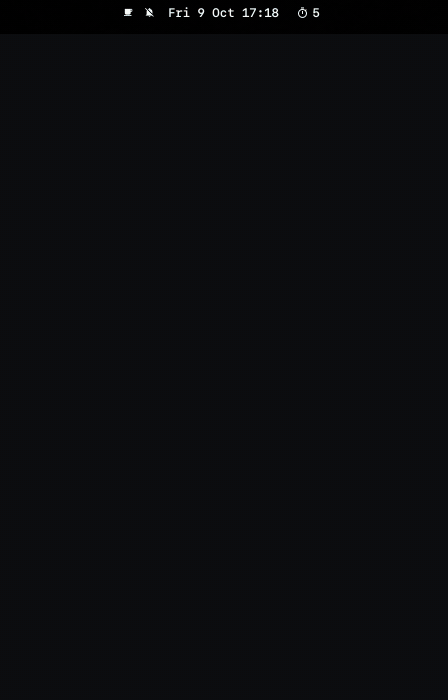

# Omarchy Focus widget

Bar widget for [Omarchy Focus](https://github.com/talhacaglar/omarchy-focus): a live pomodoro countdown in the bar, with a panel for tasks, break controls, the site guard, a daily goal, and a 12-week heatmap. It follows your Omarchy theme and updates through inotify, without polling.



## Install

The widget is a front end for the `omarchy-focus` CLI, so install that first:

```bash
yay -S omarchy-focus
```

Then add the widget:

```bash
omarchy plugin add https://github.com/talhacaglar/omarchy-focus-widget.git --enable
```

(`omarchy-focus widget install` does the same from the AUR package and keeps the widget in sync with the CLI version.)

## Use

- click: panel · right-click: start / pause / resume · middle-click: site guard
- keybinding: `omarchy-shell omarchy-focus toggle`
- settings on the widget entry in `~/.config/omarchy/shell.json`: `showIdleCount`, `refreshIntervalSec`, `guardMinutes`, `command`

This repo is a mirror of `src/omarchy_focus/shell_widget/` in the main project. Report issues and send changes there.

MIT
